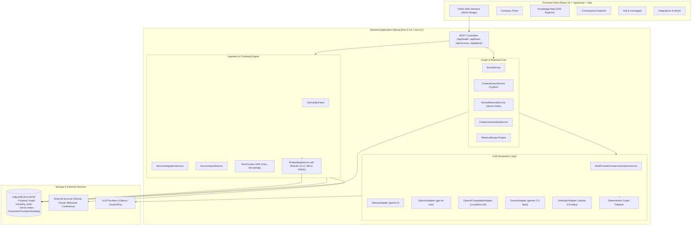

# Chittix — Enterprise Knowledge Graph & GraphRAG Platform

[](file:///D:/Projects/Antigravity/Chittix/chittix-backend)
[](file:///D:/Projects/Antigravity/Chittix/chittix-frontend)
[-red.svg)](https://www.falkordb.com/)
[](https://openjdk.org/)
[-success.svg)](file:///D:/Projects/Antigravity/Chittix/chittix-backend)
[](https://youtu.be/Tp6OwwgEjq4)

**GitHub Repository:** [https://github.com/rahulram-devendran/Chittix](https://github.com/rahulram-devendran/Chittix)  
**Demo Video:** [https://youtu.be/Tp6OwwgEjq4](https://youtu.be/Tp6OwwgEjq4)

---

## 1. Overview & Problem Statement

Modern enterprise engineering knowledge is heavily fragmented across code repositories, pull requests, architectural decision records (ADRs), wikis, and team chats. When an engineer asks:
> *"What architectural decisions govern our payment service, which team owns it, and what commits or PRs modified its retry policies?"*

Traditional tools fail in two major ways:
1. **Generic RAG & Keyword Search hallucinate or lose structural context**: Unstructured text chunking loses the relational links between a high-level **Decision**, the impacted **Project**, the downstream **System**, the responsible **Team**, and the actual **Commits/PRs**.
2. **Context Bleed & Data Leakage**: Without explicit retrieval scope enforcement, semantic search retrieves chunks from unrelated repositories or documents that happen to share lexical terms.

**Chittix** solves this by unifying **FalkorDB**'s high-speed property graph engine and native vector indexing with hybrid GraphRAG. Chittix reconstructs enterprise knowledge chains, tracks downstream architectural consequences, enforces strict retrieval boundaries, and synthesizes verifiable answers with full source provenance.

---

## 2. Core Features

### 📊 Company Pulse
- **Operational Health Dashboard**: Real-time status reporting for the backend application and FalkorDB connection (`/api/health`).
- **Telemetry & Topology Metrics**: Live counters for total nodes, relationships, and vector index health.
- **Provider Status**: Displays the active LLM engine, model name, base URL, and supported inference capabilities.

### 🌐 Knowledge Map
- **Interactive Knowledge Graph Explorer**: Visualizes real FalkorDB nodes and relationships using clean SVG rendering and dark-theme aesthetics.
- **Focused Neighborhood Mode**: Automatically centers on the active node and neatly spaces 1-hop connected neighbors in elliptical orbits, preventing center-cluster collisions.
- **Full Drag & View Controls**: Interactive cursor-based node dragging, smooth edge tracking, Zoom In/Out, Fit-to-View (`fit_screen`), and Path Highlighting (`route`).
- **Transparent Filtering**: Dynamic counts show exact visible subset versus total database volume (e.g., `Showing 12/48 nodes (Neighborhood) · 14 rels`).

### 🔀 Consequence Explorer
- **Blast-Radius Impact Analysis**: Traces architectural causality chains across `(:Decision)-[:AFFECTS]->(:Project)-[:USES]->(:System)`.
- **Ownership & Documentation Tracking**: Maps which `(:Team)` owns the project and which `(:Document)` supports the decision.
- **Decision Chain Traversal**: Inspects upstream and downstream consequences before shipping code or infrastructure modifications.

### 🔍 Ask & Investigate (Hybrid GraphRAG)
- **Dual-Engine Retrieval**: Combines Cypher graph traversal with 384-dimensional native vector search on FalkorDB (`CALL db.idx.vector.queryNodes`).
- **Strict Retrieval Scope Boundaries**: Automatically resolves entity references in questions to restrict semantic vector retrieval to verified repositories and architecture documents (`RetrievalScope`).
- **Verifiable Provenance**: Every generated response includes the model used, distinct citations, graph decision paths, and exact text evidence.
- **Deterministic Graph Fallback**: If an LLM is offline, unconfigured, or times out, Chittix automatically falls back to a deterministic, structured summary synthesized directly from verified graph facts.

### 🔌 Multi-Source Ingestion & Administration
- **Source Integrations**: Discover and ingest repositories, pull requests, commits, and wiki pages from **GitHub**, **GitLab**, **Bitbucket Cloud**, and **Confluence**.
- **Asynchronous Background Ingestion**: Non-blocking job runner with phase-by-phase logging, item tracking, and error reporting (`QUEUED`, `RUNNING`, `COMPLETED`, `FAILED`).
- **Dynamic LLM Reconfiguration**: Live provider switching (Ollama, OpenAI, OpenAI-Compatible, Gemini, Anthropic) directly via UI and REST API without server restarts.
- **Admin Security**: Loopback admin access checks (`127.0.0.1`, `::1`) protect credential-testing and runtime reconfiguration endpoints for local demonstrations.

---

## 3. Architecture



---

## 4. Graph Data Model

Chittix models enterprise knowledge inside the `company_brain` FalkorDB graph using the following entity labels and relationships:

### Node Labels
| Label | Description | Key Properties |
|---|---|---|
| `:Decision` | Architectural decision records (ADR) | `title`, `status`, `date`, `rationale` |
| `:Project` | Enterprise projects and services | `name`, `status`, `description` |
| `:System` | Core infrastructure and backend systems | `name`, `type`, `tier` |
| `:Team` | Engineering teams and squads | `name`, `department` |
| `:Document` | Source documents, commit overviews, PRs, wiki pages | `title`, `source_id`, `type` |
| `:DocumentChunk` | Vectorized text chunks for semantic similarity | `id`, `index`, `content`, `source_id`, `embedding` (vecf32, 384 dimensions) |
| `:Repository` | Git repositories imported from code hosts | `name`, `full_name`, `description`, `html_url`, `default_branch`, `source`, `source_id` |
| `:Space` | Confluence wiki documentation spaces | `key`, `name`, `description`, `html_url`, `source_id`, `source` |

### Relationship Schema
```
(:Decision)-[:AFFECTS]->(:Project)
(:Project)-[:USES]->(:System)
(:Decision)-[:SUPPORTED_BY]->(:Document)
(:Team)-[:OWNS]->(:Project)
(:Document)-[:HAS_CHUNK]->(:DocumentChunk)
(:Repository)-[:HAS_COMMIT]->(:Document)
(:Repository)-[:HAS_PR]->(:Document)
(:Space)-[:CONTAINS_PAGE]->(:Document)
```

---

## 5. Real Cypher Queries from Implementation

The following queries are taken directly from the Chittix codebase:

### Query 1: Native Vector Search with Chunk-to-Document Traversal
*Source:* [`VectorRetrievalService.java`](file:///D:/Projects/Antigravity/Chittix/chittix-backend/src/main/java/com/companybrain/service/VectorRetrievalService.java#L141-L150)

```cypher
CALL db.idx.vector.queryNodes($label, $property, $k, vecf32($queryVector)) YIELD node, score
MATCH (doc:Document)-[:HAS_CHUNK]->(node)
RETURN node.id AS chunkId,
       node.index AS chunkIndex,
       node.content AS content,
       coalesce(node.source_id, doc.source_id) AS sourceId,
       doc.title AS documentTitle,
       score
ORDER BY score ASC
```
**Purpose:** Executes native approximate nearest-neighbor vector search in FalkorDB using the 384-dimensional query embedding. It yields the matching `DocumentChunk` nodes, traverses backwards along `[:HAS_CHUNK]` to identify the parent `Document`, and returns content alongside the cosine distance score.

---

### Query 2: Enterprise Architectural Consequence Chain
*Source:* [`ContextQueryService.java`](file:///D:/Projects/Antigravity/Chittix/chittix-backend/src/main/java/com/companybrain/service/ContextQueryService.java#L24-L36)

```cypher
MATCH (d:Decision)-[r1:AFFECTS]->(p:Project)-[r2:USES]->(s:System),
      (d)-[r3:SUPPORTED_BY]->(doc:Document)
OPTIONAL MATCH (t:Team)-[r4:OWNS]->(p)
WHERE toLower($question) CONTAINS toLower(p.name)
   OR toLower($question) CONTAINS toLower(s.name)
   OR toLower($question) CONTAINS toLower(d.title)
   OR toLower($question) CONTAINS toLower(doc.title)
   OR toLower($question) CONTAINS toLower(doc.source_id)
RETURN d.title AS decision, p.name AS project, s.name AS system,
       doc.title AS documentTitle, doc.source_id AS sourceId,
       type(r1) AS affectsRel, type(r2) AS usesRel, type(r3) AS supportRel,
       t.name AS ownerTeam, type(r4) AS ownsRel
ORDER BY decision, project
```
**Purpose:** Traverses the entire relational chain from an architectural decision down to the impacted project, the underlying system, supporting documentation, and the owning team. Used by Consequence Explorer and Ask & Investigate to ground answers in verified enterprise graph structure.

---

### Query 3: Knowledge Graph Topology Extraction (Filtering Out Internal Vector Nodes)
*Source:* [`ContextQueryService.java`](file:///D:/Projects/Antigravity/Chittix/chittix-backend/src/main/java/com/companybrain/service/ContextQueryService.java#L257-L272)

```cypher
// Nodes
MATCH (n)
WHERE NOT n:DocumentChunk
RETURN id(n) AS id, labels(n) AS labels,
       coalesce(n.name, n.title, n.full_name, 'Node') AS name,
       n.source_id AS sourceId,
       properties(n) AS properties
ORDER BY id;

// Relationships
MATCH (s)-[r]->(t)
WHERE NOT s:DocumentChunk AND NOT t:DocumentChunk
RETURN id(r) AS id, id(s) AS source, id(t) AS target, type(r) AS type
ORDER BY id;
```
**Purpose:** Retrieves the clean entity topology from FalkorDB for visualization in the Knowledge Map while excluding low-level embedding chunk nodes.

---

## 6. Technology Stack

### Backend
- **Framework:** Spring Boot 3.4.5 (`spring-boot-starter-web`, `spring-boot-starter-validation`)
- **Runtime:** Java 21 LTS
- **Build Tool:** Apache Maven (via `mvnw` wrapper)
- **Graph Client:** Official JFalkorDB 0.12.0 (`com.falkordb:jfalkordb`) with Jedis 8.0.1
- **Embedding Model:** LangChain4j Quantized `all-MiniLM-L6-v2-q` (384-dimensional in-process embeddings, Apache-2.0)
- **HTTP Client:** Java 21 native `java.net.http.HttpClient`

### Frontend
- **Framework:** React 19.2.8 with TypeScript ~6.0.2
- **Build Tool & Dev Server:** Vite 8.3.0
- **Styling:** Vanilla CSS with Stitch Design System Tokens + Tailwind CSS 3.4.19
- **Linter:** Oxlint 1.81.0

### Database & Inference
- **Graph & Vector Store:** FalkorDB (`falkordb/falkordb:edge`)
- **LLM Providers:** Local Ollama (`qwen2.5:1.5b`), OpenAI (`gpt-4o-mini`), OpenAI-Compatible (vLLM/LocalAI), Google Gemini (`gemini-1.5-flash`), Anthropic Claude (`claude-3-5-haiku-20241022`).

---

## 7. API Endpoints

| Method | Endpoint | Description |
|---|---|---|
| `GET` | `/api/health` | FalkorDB connectivity check and health status |
| `POST` | `/api/brain/ask` | GraphRAG question answering with scope boundaries and provenance |
| `GET` | `/api/brain/graph` | Knowledge graph topology extraction (nodes and relationships) |
| `GET` | `/api/brain/provider-status` | Active LLM provider configuration and capabilities |
| `POST` | `/api/brain/test-provider` | Tests connectivity to an LLM provider candidate |
| `POST` | `/api/brain/configure-provider` | Activates LLM provider and model configuration dynamically |
| `GET` | `/api/demo/payments-context` | Decision-to-system context chain for the demo payment service |
| `GET` | `/api/github/status` | Current GitHub token status and rate limits |
| `POST` | `/api/github/configure` | Configures in-memory GitHub Personal Access Token (PAT) |
| `GET` | `/api/github/repos` | Lists repositories accessible to the configured GitHub identity |
| `POST` | `/api/github/import` | Enqueues background async repository metadata import job |
| `GET` | `/api/github/jobs` | Lists recent GitHub import jobs |
| `GET` | `/api/github/jobs/{jobId}` | Status and live metrics for a specific GitHub import job |
| `GET` | `/api/sources/status` | Status summary across all external sources (GitLab, Bitbucket, Confluence) |
| `POST` | `/api/sources/configure` | Configures credentials for an external provider |
| `POST` | `/api/sources/test` | Validates credentials against upstream provider API |
| `GET` | `/api/sources/{provider}/items` | Discovers available items (projects, repos, or spaces) |
| `POST` | `/api/sources/{provider}/import` | Enqueues background async import for selected items |
| `GET` | `/api/sources/jobs/{jobId}` | Status and logs for a multi-source import job |

---

## 8. Prerequisites & Local Setup

### Prerequisites
1. **Java Development Kit (JDK):** Version 21 or higher installed (`java -version`).
2. **Node.js & npm:** Node.js 20+ installed (`node -v`, `npm -v`).
3. **Docker:** Docker Desktop running to host FalkorDB.

---

### Step 1: Start FalkorDB Container
Run the official FalkorDB edge Docker container:
```bash
docker run -p 6379:6379 -it --rm falkordb/falkordb:edge
```
*Port `6379` will be accessible locally on `localhost:6379` with no password by default.*

---

### Step 2: Environment Configuration (Optional)
The backend runs with sensible local defaults out of the box (`application.properties`). To supply external API credentials via environment variables, set them in your terminal session or `.env`:

```bash
# FalkorDB Connection
FALKORDB_HOST=localhost
FALKORDB_PORT=6379
FALKORDB_GRAPH=company_brain
FALKORDB_USERNAME=
FALKORDB_PASSWORD=

# Multi-Provider LLM Configuration
CHITTIX_LLM_ENABLED=true
CHITTIX_LLM_PROVIDER=ollama
CHITTIX_LLM_MODEL=qwen2.5:1.5b
CHITTIX_LLM_BASE_URL=http://localhost:11434

# Provider API Credentials (Optional - can also be configured live in UI)
OPENAI_API_KEY=your_openai_api_key_here
GEMINI_API_KEY=your_gemini_api_key_here
ANTHROPIC_API_KEY=your_anthropic_api_key_here

# Source Integration Credentials (Optional - can also be configured live in UI)
GITHUB_TOKEN=your_github_pat_here
```

---

### Step 3: Run the Backend
From the repository root:
```bash
cd chittix-backend
# On Windows:
.\mvnw.cmd spring-boot:run

# On Linux / macOS:
./mvnw spring-boot:run
```
*The Spring Boot server starts at `http://localhost:8080`.*

---

### Step 4: Run the Frontend
In a new terminal window:
```bash
cd chittix-frontend
npm install
npm run dev
```
*The Vite development server starts at `http://localhost:5173`.*

Open your browser at `http://localhost:5173` to interact with Chittix.

---

## 9. Verification & Test Commands

### Backend Verification
Run the comprehensive Spring Boot unit and integration test suite:
```bash
cd chittix-backend
# On Windows:
.\mvnw.cmd test

# On Linux / macOS:
./mvnw test
```
**Latest Verifiable Result:**
```
[INFO] Results:
[INFO] Tests run: 222, Failures: 0, Errors: 0, Skipped: 0
[INFO] BUILD SUCCESS
```

### Frontend Build Verification
Verify TypeScript compilation and asset bundling:
```bash
cd chittix-frontend
npm run build
```
**Latest Verifiable Result:**
```
✓ 27 modules transformed.
dist/index.html                   1.08 kB
dist/assets/index-DfkH4owb.css   29.13 kB
dist/assets/index-BrEMxoaw.js   402.43 kB
✓ built in 858ms
```

---

## 10. Supported Integrations & Status

| Provider | Ingestion Status | Required Credentials | Capabilities Verified |
|---|---|---|---|
| **GitHub** | **Full** | Personal Access Token (`repo` scope for private, public requires read) | Repository discovery, metadata ingestion, commit extraction, pull request parsing, and vectorization into FalkorDB. |
| **GitLab** | **Full** | Personal Access Token (`read_api` scope) against `gitlab.com` or self-hosted | Project discovery, metadata ingestion, commit extraction, merge request parsing, and vectorization. |
| **Bitbucket Cloud** | **Full** | App Password (`username` + app password with `repository:read` and `pullrequest:read`) | Repository discovery, commit extraction, pull request parsing, and vectorization. |
| **Confluence** | **Full** | Atlassian API Token (`email` + API token) against `<site>.atlassian.net/wiki` | Space discovery, page content retrieval, HTML storage format stripping, and vectorization into FalkorDB. |
| **SVN** | *Planned* | N/A | Subversion connector is planned for future enterprise legacy migrations. |

---

## 11. Known Limitations & Security Notes

1. **Loopback Admin Restrictions:** Runtime credential modification (`/api/sources/configure`, `/api/github/configure`, `/api/brain/configure-provider`) is guarded by local loopback validation (`127.0.0.1`, `::1`). This is tailored for secure local hackathon demonstrations; production deployments should integrate enterprise SSO (OAuth2/OIDC).
2. **Ingestion Page Limits:** Confluence spaces currently fetch the top 25 pages per space and Git repositories fetch up to 20 recent commits/PRs by default. These thresholds ensure fast interactive imports during evaluations and can be raised via configuration.
3. **In-Memory Job History:** Active ingestion job history is retained in memory by `JobState` instances and is reset if the backend server process restarts. Graph data and vector embeddings persisted in FalkorDB remain permanently stored across restarts.

---

## 12. Demo & Project Links

- **Demo Video:** [https://youtu.be/Tp6OwwgEjq4](https://youtu.be/Tp6OwwgEjq4)
- **GitHub Repository:** [https://github.com/rahulram-devendran/Chittix](https://github.com/rahulram-devendran/Chittix)
- **FalkorDB:** [https://www.falkordb.com/](https://www.falkordb.com/)
